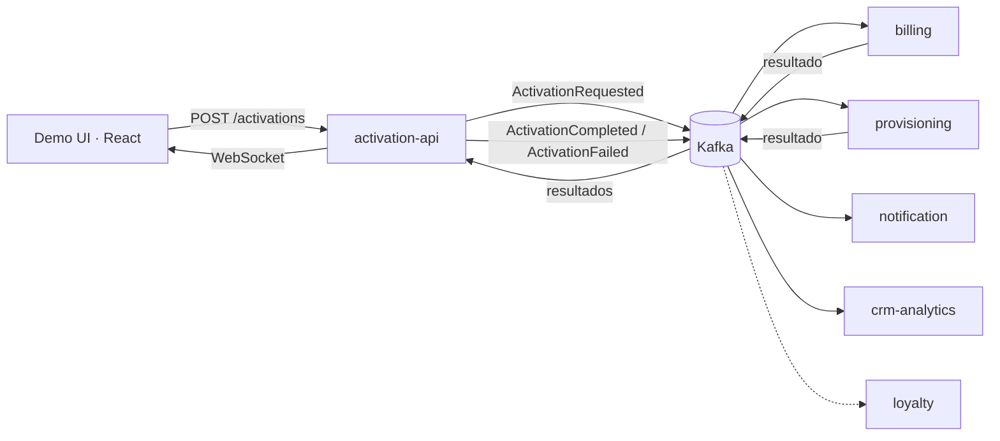

# POC Activación de Servicios con Kafka

Licenciatura en Sistemas de Información · Programación Avanzada 2026 · FCyT, Sede Concepción del Uruguay

**Autor:** Poggio Joaquin Pablo

Prueba de concepto que demuestra que la activación de un plan se puede resolver publicando **un único evento en Kafka**, sin que ningún servicio llame directamente a otro. Un cliente contrata un plan desde una UI en React; eso dispara facturación, aprovisionamiento, notificación y registro en CRM, coordinados solo por eventos.

## Qué demuestra

1. **Fan-out:** un evento de negocio produce varias reacciones independientes.
2. **Saga con compensación:** si el aprovisionamiento falla, la cuenta de facturación se anula sin llamadas directas.
3. **Conceptos de Kafka visibles en vivo:** offsets, consumer groups, particiones por clave y replay.
4. **Base reutilizable:** contratos de eventos versionados y una librería compartida con idempotencia, reintentos y DLQ.

## Arquitectura

`activation-api` es el único punto de entrada. Todo lo demás reacciona a eventos en Kafka.



Billing y provisioning trabajan **en paralelo** sobre el mismo evento. `activation-api` junta ambos resultados y decide: con los dos OK publica `ActivationCompleted`; con el primer fallo publica `ActivationFailed`, y billing anula la cuenta (compensación).

### Servicios

| Servicio | Rol | Consumer group |
|---|---|---|
| `activation-api` | REST + WebSocket + agregador de la saga | `activation-api` |
| `billing-service` | Crea la cuenta simulada; la anula ante `ActivationFailed` | `billing-svc` |
| `provisioning-service` | Simula el aprovisionamiento (1 a 3 s); puede fallar a pedido | `provisioning-svc` |
| `notification-service` | Envía el email de bienvenida o de error a Mailhog | `notification-svc` |
| `crm-analytics-service` | Registra todos los eventos; no publica nada | `crm-analytics` |
| `loyalty-service` | Suma 100 puntos por activación (escenario 5) | `loyalty` |
| `demo-ui` | Formulario "Contratar plan" y timeline en vivo | n/a |

### Topics

Cuatro topics de negocio más su DLQ. Todos con 3 particiones, retención de 7 días y `customerId` como clave (los eventos de un mismo cliente se procesan en orden).

| Topic | Eventos | Productor |
|---|---|---|
| `activation.requested` | `ActivationRequested` | activation-api |
| `billing.events` | `BillingAccountCreated`, `BillingFailed`, `BillingAccountCancelled` | billing |
| `provisioning.events` | `ProvisioningCompleted`, `ProvisioningFailed` | provisioning |
| `activation.events` | `ActivationCompleted`, `ActivationFailed` | activation-api |
| `<topic>.dlq` | mensajes que fallaron 3 veces | el consumidor que falló |

Todos los eventos comparten el mismo sobre (`eventId`, `eventType`, `version`, `occurredAt`, `correlationId`, `customerId`, `source`, `payload`). Los contratos viven en `libs/contracts`.

### Estados de la activación

`PENDING` → `IN_PROGRESS` → `ACTIVE` o `FAILED` (con compensación).

## Stack

Apache Kafka (KRaft, 1 broker) · NestJS + `@nestjs/microservices` (transporte Kafka) · React + Vite + socket.io-client · MongoDB (replica set de 1 nodo, una base por servicio) · Kafka UI · Mailhog · Docker Compose.

## Cómo levantarlo

**Requisitos:** Docker Desktop abierto. Para desarrollo local, Node 24.

```cmd
docker compose up -d --build
```

La primera vez construye las imágenes (unos minutos). Cada servicio compila al arrancar, así que tarda uno o dos minutos en estar listo. Para ver el estado:

```cmd
docker compose ps
docker compose logs -f activation-api
```

| Qué | URL |
|---|---|
| Demo UI | http://localhost:5173 |
| API | http://localhost:3000 |
| Kafka UI | http://localhost:8080 |
| Mailhog (emails) | http://localhost:8025 |

`loyalty-service` no se levanta por defecto (es el escenario 5, ver más abajo).

### Probar la API a mano

```cmd
curl -i -X POST http://localhost:3000/activations -H "Content-Type: application/json" -d "{\"customerId\":\"C-1234\",\"planId\":\"FLOW-FULL\"}"
curl http://localhost:3000/activations/act-XXXXXXXX
```

`POST /activations` responde `202 Accepted` con el `activationId` y el estado `PENDING`, sin esperar a los demás servicios. El campo opcional `simulateFailure` acepta `none`, `billing` o `provisioning`. `GET /activations/:id` devuelve el estado actual y el historial de eventos.

## Guion de la demo

Pantalla dividida: Demo UI a la izquierda, Kafka UI a la derecha.

| # | Escenario | Qué se hace | Concepto |
|---|---|---|---|
| 1 | Camino feliz | Contratar un plan sin fallo | Fan-out: un evento, varias reacciones |
| 2 | Fallo y compensación | Contratar con fallo en provisioning | Saga sin llamadas directas |
| 3 | Servicio caído | Detener notification, crear 3 activaciones, volver a levantarlo | Offset: nadie pierde mensajes |
| 4 | Escalar | Levantar una segunda instancia de billing | Consumer group y particiones |
| 5 | Nuevo consumidor | Levantar loyalty con un grupo nuevo | Replay del log |

```cmd
:: Escenario 3
docker compose stop notification-service
:: ...crear 3 activaciones; Kafka UI → Consumers → notification-svc muestra lag 3...
docker compose start notification-service

:: Escenario 4
docker compose up -d --scale billing-service=2

:: Escenario 5 (loyalty lee desde el inicio: auto.offset.reset=earliest)
docker compose --profile loyalty up -d loyalty-service
```

### Pruebas de confiabilidad

- **Idempotencia:** en Kafka UI → `activation.requested` → *Produce Message*, reenviar un mensaje existente con la misma key y el mismo value. Billing registra `Evento repetido ...: descartado` y no se crean cuentas ni emails duplicados.
- **DLQ:** producir en `activation.requested` la key `C-1234` y el value `{"mensaje":"invalido"}`. Tras los reintentos (1 s, 2 s, 4 s) el mensaje aparece en `activation.requested.dlq` con el motivo del error en los headers, y el resto del flujo sigue.
- **Trazabilidad:** todos los eventos de una activación llevan el mismo `correlationId`.

```cmd
  docker compose exec mongo mongosh crm-analytics --quiet --eval "db.event_log.find({correlationId:'act-XXXXXXXX'}).toArray()"
```

## Decisiones técnicas

- **Idempotencia en cada consumidor:** Kafka entrega "al menos una vez". Cada consumidor inserta el `eventId` en `processed_events` (índice único, TTL de 7 días) dentro de la **misma transacción de Mongo** que su efecto. Por eso Mongo corre como replica set.
- **Reintentos y DLQ:** ante un error técnico se reintenta 3 veces con espera creciente (1, 2 y 4 s); si sigue fallando, el mensaje original va a `<topic>.dlq` con el motivo en los headers y el consumidor continúa. Los fallos de negocio simulados no son errores técnicos: se publican como `BillingFailed` o `ProvisioningFailed`.
- **Coreografía con agregador:** billing y provisioning reaccionan solos al evento. Es más simple que un orquestador y muestra mejor el desacople.
- **Caso borde de la saga:** si `ActivationFailed` llega a billing antes de que cree la cuenta, billing la anula igual al crearla.
- **Cliente Kafka aislado:** el uso de `kafkajs` está encapsulado en `libs/kafka-toolkit`, para poder reemplazarlo si hiciera falta.

## Estructura del repo

```
activation-poc/
├── apps/
│   ├── activation-api/          REST + WebSocket + agregador de la saga
│   ├── billing-service/
│   ├── provisioning-service/
│   ├── notification-service/
│   ├── crm-analytics-service/
│   ├── loyalty-service/
│   └── demo-ui/                 React + Vite + socket.io-client
├── libs/
│   ├── contracts/               tipos de eventos, sobre común, nombres de topics
│   └── kafka-toolkit/           publicación, idempotencia, reintentos y DLQ
├── docker/
│   ├── create-topics.sh         crea los topics con 3 particiones
│   └── Dockerfile.node          imagen común de los servicios Nest
└── docker-compose.yml
```

## Desarrollo local (sin contenedores para las apps)

Con la infraestructura en Docker (`docker compose up -d kafka kafka-init mongo mailhog kafka-ui`), cada servicio se corre en su propia terminal:

```cmd
npm install
nest start activation-api --builder tsc --watch
nest start billing-service --watch
nest start provisioning-service --watch
nest start notification-service --watch
nest start crm-analytics-service --watch
cd apps\demo-ui && npm install && npm run dev
```

Desde la máquina local, los servicios usan `localhost:9092` (Kafka) y `mongodb://localhost:27017/...?directConnection=true` (Mongo). Dentro de Docker se usan `kafka:19092` y `mongo:27017` por variables de entorno.

## Problemas conocidos

- **`activation-api` se compila con `tsc` y no con rspack:** el empaquetado de rspack rompe Socket.IO (`engine.io`).
- **Imports de `mongoose` como `import type`:** en ejecución nativa (Docker) Node no puede tomar `Model` ni `Connection` como exports de un paquete CommonJS. Como solo se usan como tipos, se importan con `import type`.
- **Kafka tarda en arrancar:** los servicios esperan a `kafka` (`healthy`) y a `kafka-init` con `depends_on`. Aun así, pueden aparecer unos segundos de `The group coordinator is not available` al inicio, y kafkajs reintenta solo.
- **El historial de Kafka no persiste:** el broker no tiene volumen. `docker compose down` borra los mensajes (no los datos de Mongo).
- **Rebalanceo al escalar billing (escenario 4):** hay una pausa de varios segundos mientras Kafka reparte las particiones; es parte de la demo.

## Alcance

**Incluido:** todo corre en local con Docker Compose y simula los sistemas externos.

**Fuera de alcance:** integración con sistemas reales, autenticación, alta disponibilidad (varios brokers y réplicas), pruebas de carga y Schema Registry.

**Fase 4 (opcional, no implementada):** outbox transaccional. Hoy `activation-api` guarda en Mongo y publica a continuación; si el proceso se cae entre ambos pasos, el evento se pierde. Este riesgo está documentado en el código y se resolvería con un outbox.